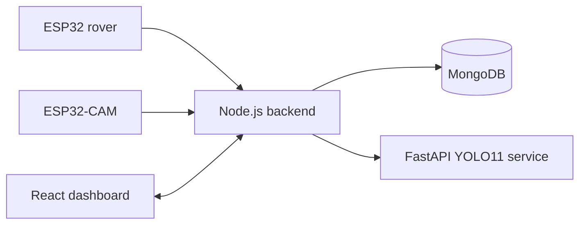
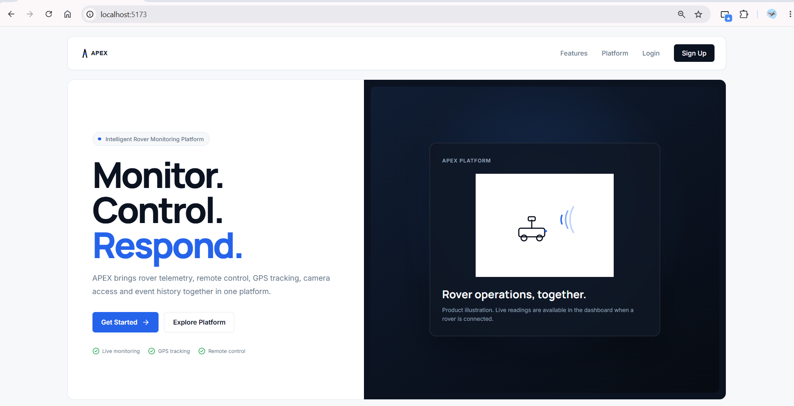
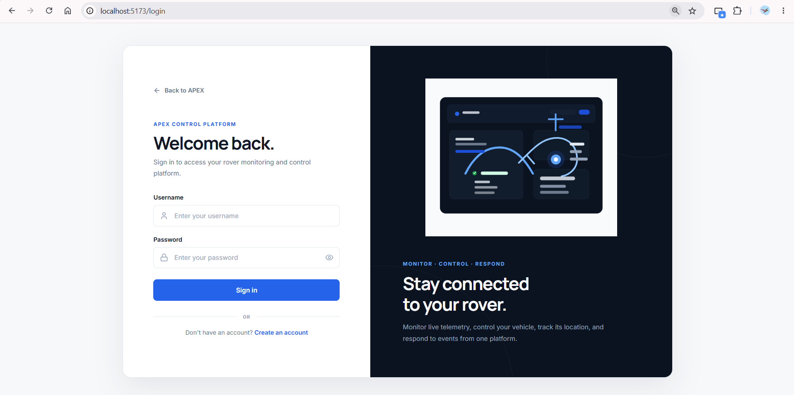
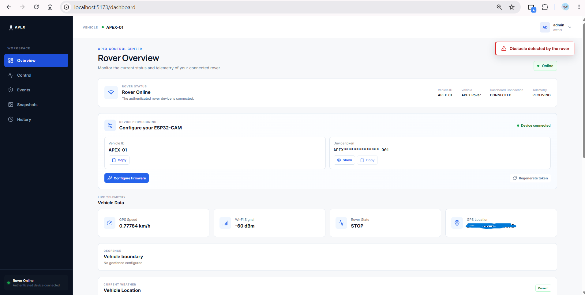
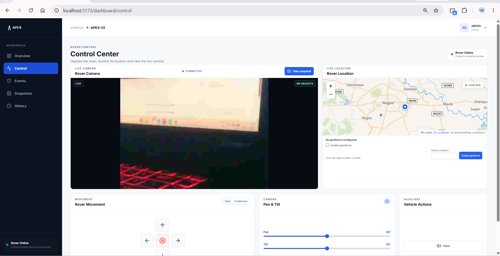
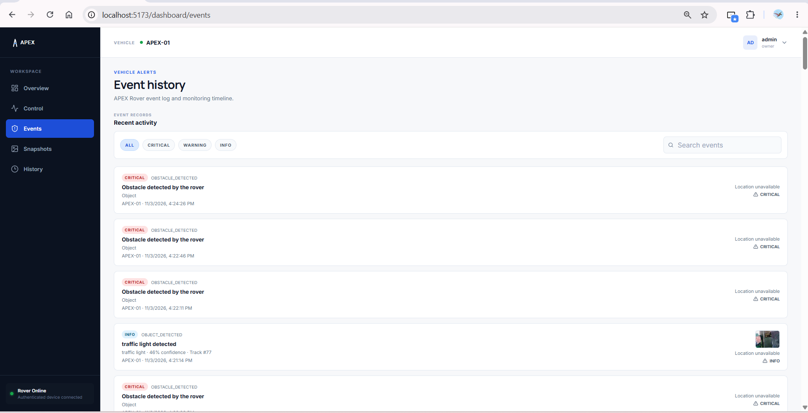
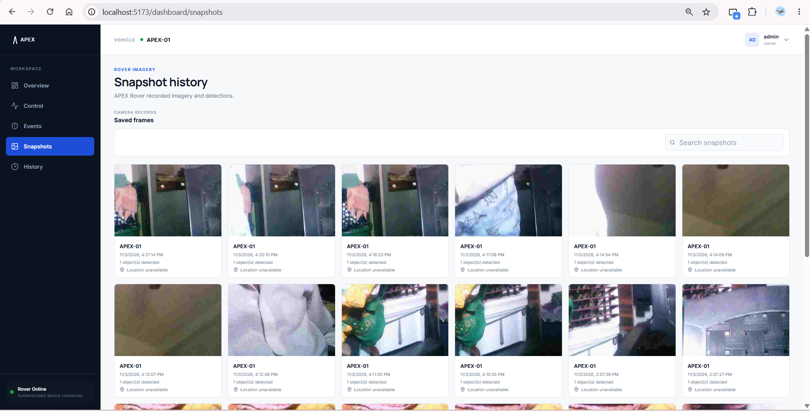

# APEX

## Advanced Platform for Event Intelligence and Execution

APEX is an IoT-based smart surveillance and monitoring system for an
ESP32-powered rover. It combines a web dashboard, live camera streaming,
telemetry, remote control, object detection, snapshots, and event history.

## Problem statement

Monitoring a moving device usually requires separate tools for camera video,
sensor values, controls, and recorded events. This makes the system harder to
operate and harder to understand.

## Proposed solution

APEX brings these functions into one dashboard. The ESP32 rover sends
telemetry, the ESP32-CAM sends images, the backend manages communication, and
the AI service checks selected images for objects.

## Objectives and scope

- View the rover camera from a browser.
- Monitor GPS, sensor, and connection status.
- Send movement, stop, horn, and pan/tilt commands.
- Detect objects with YOLO11 and ByteTrack.
- Save snapshots and events in MongoDB.
- Provide authenticated access for users and devices.

APEX is currently designed for local development and LAN-based hardware
testing. It does not claim vehicle recognition, cloud recording, or a public
production deployment.

## Main features

### Dashboard

The React dashboard includes landing, login, signup, overview, control,
events, snapshots, and history pages. The overview shows the current vehicle
status, telemetry, GPS information, weather, camera feed, and device setup.

### Camera monitoring

The ESP32-CAM captures JPEG images and sends them as binary WebSocket messages
to the backend. The backend verifies the device and forwards valid frames to
the logged-in dashboard.

### Rover control and telemetry

The ESP32 rover sends telemetry such as GPS, Wi-Fi signal, and rover state.
The dashboard sends validated movement, stop, horn, pan, and tilt commands
through the backend.

### Events and snapshots

Users can save camera snapshots and view event history. Detection events may
include the object class, confidence, tracking ID, location, and snapshot
reference.

### AI processing

The FastAPI AI service uses Ultralytics YOLO11 for object detection and
ByteTrack for tracking objects between frames. The backend sends JPEG frames
to `/detect` when detection is enabled.

## Technology stack

| Technology | Purpose | Location |
| --- | --- | --- |
| React, Vite | Web dashboard | `frontend/` |
| Redux Toolkit | Login and vehicle state | `frontend/src/redux/` |
| Node.js, Express | REST API and server | `backend/` |
| MongoDB, Mongoose | Data storage | `backend/src/models/` |
| WebSocket (`ws`) | Live device and camera communication | `backend/src/websocket/` |
| Python, FastAPI | AI service | `ai-service/` |
| YOLO11, ByteTrack | Detection and tracking | `ai-service/main.py` |
| ESP32 and ESP32-CAM | Rover control and image capture | `esp32/firmware/` |

## Hardware components

- ESP32 rover controller
- ESP32-CAM board and camera module
- Motor driver and motors
- Ultrasonic sensor
- Flame sensor and buzzer
- Pan and tilt servos
- Optional GPS module
- USB-to-serial programmer and stable power supply

## System architecture



## How APEX works

1. A user registers or signs in to the dashboard.
2. The backend provisions a vehicle ID and device token.
3. The rover connects over WebSocket and sends telemetry.
4. The ESP32-CAM connects and sends JPEG camera frames.
5. The backend sends live data to the dashboard.
6. Selected images are sent to the AI service.
7. Detection results, snapshots, and events are stored in MongoDB.

## Screenshots

<p align="center">
  
  
</p>
<p align="center">
  
  
</p>
<p align="center">
  
  
</p>

More interface images are available in
[`docs/assets/screenshots/`](docs/assets/screenshots/). Hardware photographs
for the ESP32 boards are not currently included in the repository.

## Installation and local setup

### Requirements

- Node.js and pnpm
- Python 3.12
- MongoDB
- Arduino IDE with ESP32 board support

### Install and configure

```powershell
pnpm --dir backend install
pnpm --dir frontend install
Copy-Item backend/.env.example backend/.env
Copy-Item frontend/.env.example frontend/.env
Copy-Item ai-service/.env.example ai-service/.env
```

Set local placeholder values as described in
[docs/ENV.md](docs/ENV.md). Do not commit passwords, tokens, database
credentials, or Wi-Fi details.

### Start services

```powershell
pnpm --dir backend dev
pnpm --dir frontend dev
```

In another PowerShell terminal:

```powershell
Set-Location ai-service
py -3.12 -m venv .venv
.\.venv\Scripts\Activate.ps1
python -m pip install -r requirements.txt
python -m uvicorn main:app --host 0.0.0.0 --port 8000
```

Local defaults are backend `3000`, frontend `5173`, and AI service `8000`.
Hardware setup is documented in [docs/ESP32DEVKIT.md](docs/ESP32DEVKIT.md) and
[docs/ESP32CAM.md](docs/ESP32CAM.md).

## Deployment

No verified public frontend, backend, or API links are stored in this
repository. Use `localhost` for local work and publish real links only after
they have been confirmed.

## Documentation

- [Documentation index](docs/README.md)
- [Architecture](docs/ARCHITECTURE.md)
- [API](docs/API.md)
- [Database](docs/DB.md)
- [Environment](docs/ENV.md)
- [ESP32-CAM](docs/ESP32CAM.md)
- [ESP32 DevKit](docs/ESP32DEVKIT.md)
- [Folder structure](docs/FOLDER_STRUCTURE.md)

## Project information

**Project Name:** APEX – Advanced Platform for Event Intelligence and Execution
**Project Category:** BCA Final Year Project

**Project Members**

1. Sushrut Gondane
2. Vedant Dahare
3. Sayali Goverdipe
4. Dimple Goverdipe
5. Vaidehi Saratkar
6. Samikshya Kadu
