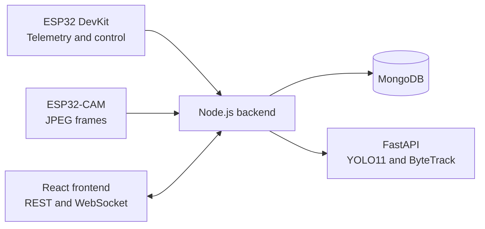

# APEX Architecture

APEX is divided into hardware, software, and storage components. Each
component has a clear responsibility, while the backend connects the complete
system.

## System overview

The ESP32 DevKit controls the rover and sends telemetry. The ESP32-CAM
captures images. Both devices connect to the Node.js backend. The React
frontend communicates with the backend using REST requests and WebSockets.
MongoDB stores users, vehicles, events, and snapshots. The FastAPI AI service
processes selected JPEG frames.

## Hardware architecture

The ESP32 DevKit reads the rover sensors, controls motors and servos, and
communicates with the backend. The firmware includes pins for an ultrasonic
sensor, flame sensor, buzzer, pan/tilt servos, motor driver, and GPS serial
connection.

The ESP32-CAM has a separate job. It initializes the camera in JPEG mode and
sends binary frames. It does not connect directly to the React frontend.

## Software architecture

### Frontend

The frontend is a React/Vite application. It contains public authentication
pages and protected dashboard pages. Redux Toolkit stores authentication and
vehicle state. Axios is used for REST requests, while the browser WebSocket
client receives live camera and telemetry data.

### Backend

The backend is an Express application started by `backend/src/server.js`.
`backend/src/app.js` configures middleware, health routes, authentication
routes, and vehicle routes. The WebSocket server handles dashboard, rover,
and camera connections.

### Database

MongoDB stores the `User`, `Vehicle`, `Event`, and `Snapshot` models. A user is
linked to a vehicle, and events and snapshots are linked to that vehicle.
This relationship allows the backend to enforce owner-only access.

### AI service

`ai-service/main.py` exposes a FastAPI service. The backend sends JPEG bytes to
`POST /detect`. YOLO11 returns object detections and ByteTrack maintains
tracking IDs for each camera. The AI service is optional for live streaming;
the camera feed can still work when detection is disabled.

## Communication

| Connection | Method | Data |
| --- | --- | --- |
| Frontend to backend | REST | Login, vehicle data, history, snapshots |
| Frontend to backend | WebSocket | Live frames, telemetry, status, commands |
| Rover to backend | WebSocket | Telemetry and command acknowledgements |
| Camera to backend | WebSocket | Binary JPEG frames |
| Backend to AI service | HTTP | JPEG detection requests and JSON results |
| Backend to MongoDB | Mongoose | Users, vehicles, events, snapshots |

## Complete workflow

1. The user registers or logs in.
2. The backend creates or loads the user's vehicle.
3. The rover and camera authenticate with device ID and device token.
4. The rover sends telemetry and waits for commands.
5. The camera sends JPEG frames to the backend.
6. The backend forwards frames to the dashboard.
7. When enabled, the backend sends selected frames to the AI service.
8. Detection results are sent to the dashboard and may create events and
   snapshots.
