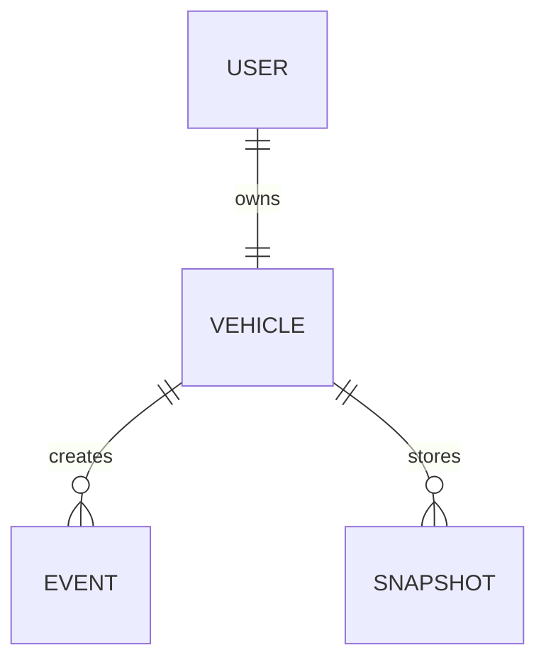

# APEX Database Reference

APEX uses MongoDB through Mongoose. MongoDB is suitable because telemetry and
detection details contain nested and changing data. The backend opens the
connection using `MONGODB_URI` in `backend/.env`; credentials are never part of
this documentation.

The connection is configured with `MONGODB_URI` in `backend/.env`.

## Collections and models

| Model | Purpose | Important fields |
| --- | --- | --- |
| `User` | Account and ownership | fullName, email, username, passwordHash, vehicleId, role, timestamps |
| `Vehicle` | Rover identity and current state | vehicleId, name, owner, deviceToken, status, telemetry, lastTelemetryAt, lastSeenAt, geofence, timestamps |
| `Event` | Alerts and system events | vehicle, vehicleId, isDeleted, deletedAt, type, message, location, details, timestamps |
| `Snapshot` | Captured JPEG images | vehicle, vehicleId, isDeleted, deletedAt, image, contentType, detections, location, dimensions, source, eventId, timestamps |

`User.vehicleId` and `Vehicle.owner` connect a user to one vehicle. Events and
snapshots reference the vehicle. `Snapshot.eventId` optionally links an
automatic snapshot to its detection event.

## User model

| Field | Type | Details |
| --- | --- | --- |
| `fullName` | String | Required, 2–80 characters |
| `email` | String | Required, unique, lowercase |
| `username` | String | Required and unique |
| `passwordHash` | String | Required bcrypt hash |
| `vehicleId` | String | Required and unique |
| `role` | String | Defaults to `owner` |
| `createdAt`, `updatedAt` | Date | Automatic timestamps |

## Vehicle model

`owner` is a required unique reference to `User`. `status` is `online` or
`offline`. `telemetry` is a mixed object because its sensor fields come from
the firmware.

| Geofence field | Type | Values |
| --- | --- | --- |
| `enabled` | Boolean | Defaults to `false` |
| `latitude`, `longitude` | Number | Coordinates or `null` |
| `radiusMeters` | Number | Radius or `null` |
| `state` | String | `UNKNOWN`, `INSIDE`, or `OUTSIDE` |

## Event model

`type` is one of `GEOFENCE_VIOLATION`, `SNAPSHOT`, `OBJECT_DETECTED`,
`FIRE_DETECTED`, or `OBSTACLE_DETECTED`. Location and `details` may be
`null`. Detection events store class, confidence, track ID, and snapshot
reference inside `details`.

## Snapshot model

| Field | Type | Details |
| --- | --- | --- |
| `image` | Buffer | Required JPEG data; excluded by default from queries |
| `contentType` | String | `image/jpeg` |
| `detectedObjects` | Mixed array | Detection results |
| `detectionStatus` | String | `AVAILABLE` or `UNAVAILABLE` |
| `imageWidth`, `imageHeight` | Number | Image dimensions or `null` |
| `source` | String | Defaults to `ESP32-CAM` |
| `eventId` | ObjectId | Optional `Event` reference |

Snapshot history excludes image bytes for performance. The image route selects
the bytes and returns them as a JPEG after checking vehicle ownership.

## Indexes

The Event and Snapshot schemas index vehicle identifiers, deletion flags, and
timestamps. Compound indexes include:

- `{ vehicle: 1, createdAt: -1 }`
- `{ isDeleted: 1, createdAt: -1 }`
- `{ vehicle: 1, isDeleted: 1, createdAt: -1 }`

These indexes support owner history queries that filter active records and
sort newest first.

## Soft deletion and retention

`isDeleted` and `deletedAt` exist on Event and Snapshot. Normal history queries
filter with `isDeleted: false`, so a marked record is hidden without removing
it immediately.

The repository does not contain a scheduled cleanup job. Therefore, a
0–6-month active, 6–12-month soft-delete, and 12+ month permanent-delete
lifecycle is a planned retention policy, not an active automated feature.
