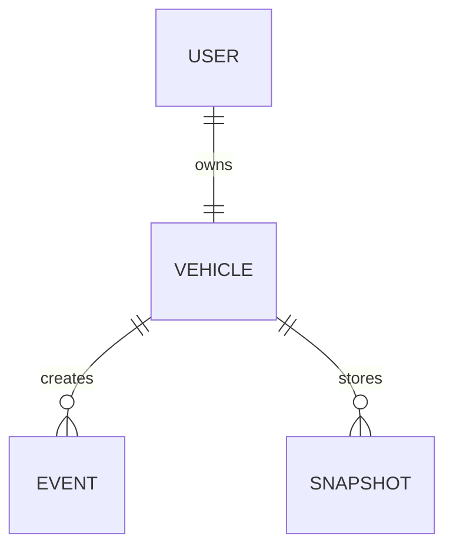

# APEX Database

APEX uses MongoDB through Mongoose. MongoDB is suitable because telemetry and
detection details contain nested and changing data.

The connection is configured with `MONGODB_URI` in `backend/.env`.

## Collections and models

| Model | Purpose | Important fields |
| --- | --- | --- |
| `User` | Account and ownership | username/email, password hash, vehicle ID, role |
| `Vehicle` | Rover identity and current state | vehicle ID, owner, device token, status, telemetry, geofence |
| `Event` | Alerts and system events | vehicle, type, message, location, details, timestamps |
| `Snapshot` | Captured JPEG images | vehicle, image, content type, detections, location, timestamps |

`User.vehicleId` and `Vehicle.owner` connect a user to one vehicle. Events and
snapshots reference the vehicle. Backend controllers use these relationships
to enforce owner-only access.

Snapshot images are stored as JPEG data with detection metadata. Vehicle
documents contain the latest telemetry and connection status. The schemas are
defined in `backend/src/models/`.
